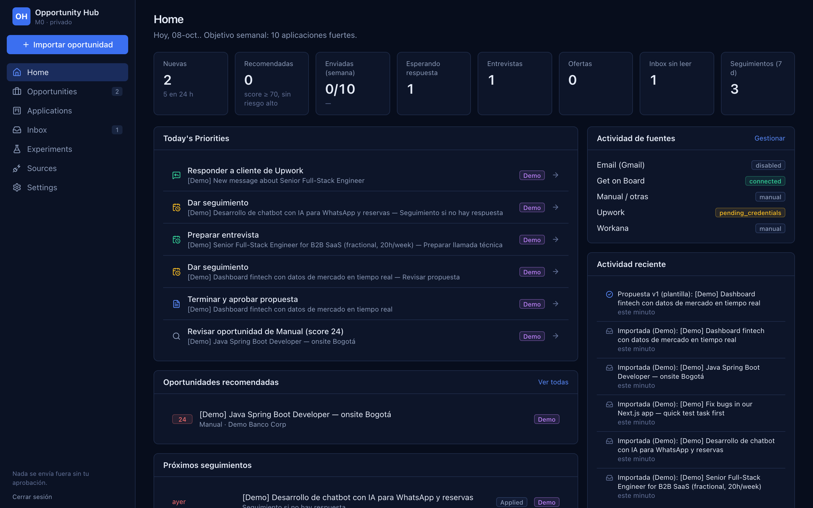
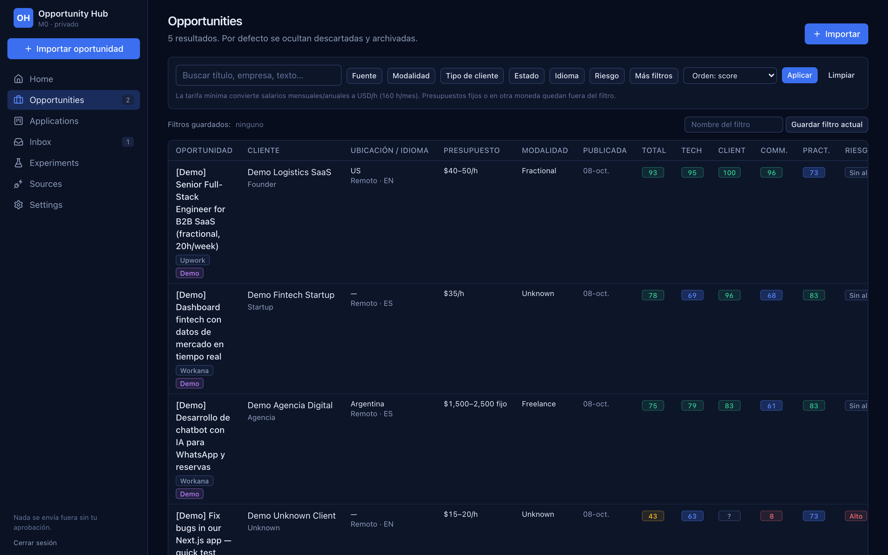
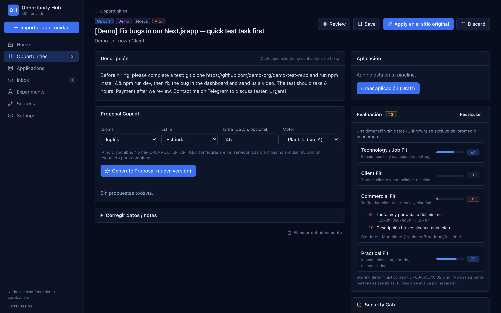
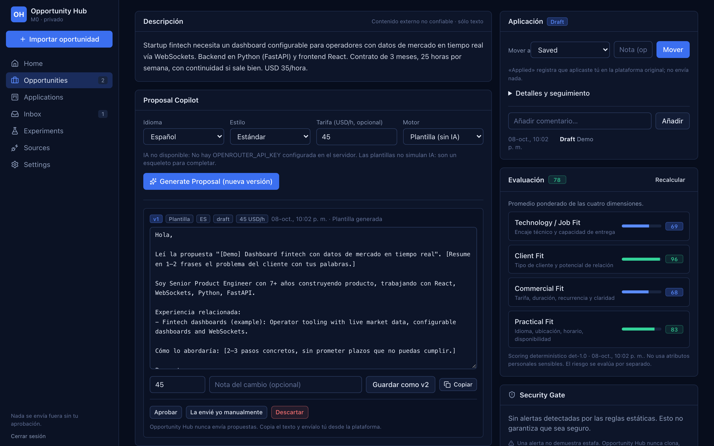
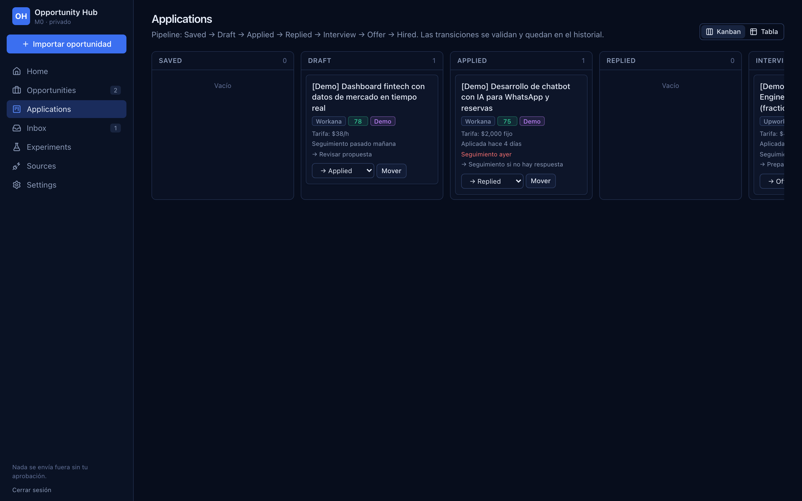
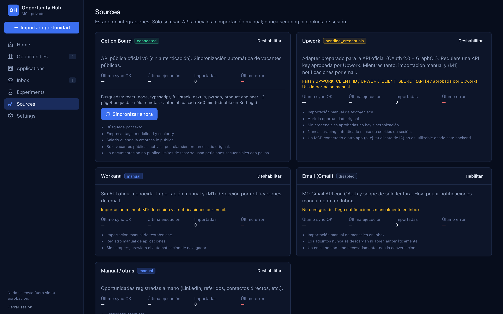
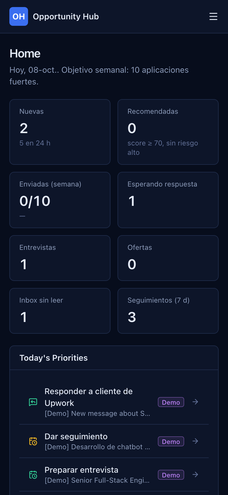

# Opportunity Hub

**A private, self-hosted CRM for freelance, fractional and full-time opportunities.** It pulls jobs from official sources, normalizes and de-duplicates them, and scores them with explainable reasons. It flags security risks, drafts proposals and tracks every application through a pipeline. **It never sends anything on your behalf.**



> **Status:** M0 (MVP), built for a single user and run with Docker on a small VM. The UI is currently in Spanish; code, docs and data model are in English.

---

## Why

Checking several job platforms by hand takes a lot of time, and most "auto-apply" tools trade quality for volume and break platform rules. Opportunity Hub takes the opposite approach:

- **Autonomous on internal work:** importing, normalizing, de-duplicating, scoring, risk detection, drafting and prioritizing.
- **Human-in-the-loop for anything external:** proposals, messages, contracts and platform credits always go through you on the original site.
- **Official integrations only:** no scraping, no browser automation and no reuse of session cookies.

## Features

| Area | What it does |
|---|---|
| **Sources** | Real sync with the [Get on Board](https://www.getonbrd.com) public API (manual and scheduled), with run history and errors. Manual import (text + link) for Workana, Upwork or any other source. Adapters for the official Upwork API and for Gmail are prepared but not connected yet |
| **Normalization & de-dup** | Idempotent ingestion. Identity is the external id, then the canonical URL, then a content hash. Cross-source look-alikes are flagged, never merged silently. Every field records where it came from: **source**, **manual** or **inferred** |
| **Explainable scoring** | Four separate scores (Technology/Job, Client, Commercial, Practical), each with reasons and evidence snippets. Missing data shows as **Unknown** instead of a guess. A **confidence level** (high/medium/low) says how much of the score rests on known data, and only medium/high-confidence, eligible, non-high-risk items are ever *recommended*. Budgets are never converted between currencies implicitly. Weights are configurable and no sensitive personal attributes are used |
| **Geographic eligibility** | Distinguishes fully remote, remote-restricted (`remote_local`), hybrid and onsite work. The result is `eligible`, `ineligible` (explicit evidence only) or `needs_review` (insufficient information is never treated as incompatible), and it is computed against the location in your profile |
| **Security Gate** | Static checks on text **and URLs** (the original link and links inside notifications): external repos or ZIPs, executable take-home tests, unusual links (raw IPs, punycode, shorteners, executables, embedded credentials, a domain that doesn't match the platform), crypto/wallet requests, credential requests, off-platform payment, prompt injection and unreasonable unpaid assessments. URLs are parsed, never fetched. It never clones, installs or runs third-party code |
| **Pipeline** | Saved → Draft → Applied → Replied → Interview → Offer → Hired (plus Rejected, Withdrawn and Archived). Transitions are validated, with history, comments, follow-ups and rates |
| **Proposal Copilot** | Optional LLM drafting via OpenRouter, server-side, with caching, a daily budget, timeouts and JSON validation. Without a key it falls back to a clearly labelled template and **never fakes AI output**. Drafts are versioned and can be copied |
| **Inbox** | Paste notifications to classify them, link them to applications and scan them for risks. Messages are marked as partial and always keep a link to the original conversation |
| **Experiments** | Response, interview and hire funnels per variant and per segment (source, language, client type, rate…), computed from **status-history milestones**: a later rejection doesn't erase an earlier interview. Includes small-sample warnings and never auto-tunes your strategy |
| **Today's Priorities** | Replies to answer, due follow-ups, interviews, approved proposals not yet sent and the best new opportunities |

## Screenshots

All screenshots use synthetic **Demo** data and a generic example profile.

| Opportunities | Opportunity detail & Security Gate |
|---|---|
|  |  |
| **Proposal Copilot** | **Applications (Kanban)** |
|  |  |
| **Sources** | **Mobile** |
|  |  |

## Architecture

A modular monolith that can be split up later if needed. M0 deliberately has no queues, Redis or microservices.

```
Browser ──► Next.js 16 (App Router, Server Components + Server Actions)
              │  proxy.ts → session check on every route
              ├─ features/*        UI + queries + server actions per domain
              └─ server/*
                   connectors/     getonboard (live) · manual · upwork/workana/email (prepared)
                   ingestion/      normalize → dedupe → upsert → provenance → score + risks
                   scoring/        deterministic engine + score history
                   security/       Security Gate rules
                   ai/ proposals/  OpenRouter client (optional) + proposal generator
                   scheduling/     in-process scheduler guarded by a Postgres advisory lock
              ▼
           PostgreSQL 16 (Drizzle ORM, versioned SQL migrations)
```

```
src/
  app/            routes: (app)/ authenticated area, login/, api/health
  components/     shared UI primitives (dark navy theme, accessible forms)
  features/       opportunities, applications, proposals, inbox, sources, settings, experiments, dashboard
  server/         db, auth, connectors, ingestion, normalization, deduplication, scoring, security, ai, inbox, scheduling
  proxy.ts        auth gate (Next 16's replacement for middleware)
  instrumentation.ts  production safety checks + scheduler bootstrap
drizzle/          SQL migrations
tests/            unit (Vitest) + e2e (Playwright) + synthetic fixtures
```

**Tech stack:** Next.js 16 · React 19 · TypeScript · Tailwind CSS 4 · PostgreSQL 16 · Drizzle ORM · Zod 4 · Vitest · Playwright · Docker Compose · OpenRouter (optional).

The project uses Drizzle rather than Prisma because Drizzle has no binary query engine or sidecar process, which keeps memory low on a shared VM. Its migrations are readable SQL and its types are inferred from the schema.

## Getting started

### Requirements

- Docker with Docker Compose v2
- Node.js 22 (only for local development)

### Run with Docker

```bash
git clone https://github.com/hector53/opportunity-hub.git
cd opportunity-hub
cp .env.example .env
# Edit .env: POSTGRES_PASSWORD (also inside DATABASE_URL), AUTH_SECRET, APP_PASSWORD_HASH
openssl rand -base64 48                                    # → AUTH_SECRET
docker compose --profile tools run --rm tools npm run auth:hash -- 'a long password'   # → APP_PASSWORD_HASH

docker compose up -d --build                               # applies migrations on start
docker compose --profile tools run --rm tools npm run db:seed              # sources + settings
docker compose --profile tools run --rm tools npm run db:seed -- --demo    # optional demo data
```

Open **http://127.0.0.1:3100** and sign in. Then go to **Sources → Sincronizar ahora** (Sync now) to pull live Get on Board jobs.

Ports bind to `127.0.0.1` only. To reach a remote VM, use an SSH tunnel (see [docs/DEPLOYMENT.md](docs/DEPLOYMENT.md)).

### Local development

```bash
npm ci
docker compose up -d db
npm run db:migrate && npm run db:seed -- --demo
npm run dev                      # http://127.0.0.1:3100
```

## Configuration

| Variable | Required | Description |
|---|---|---|
| `POSTGRES_PASSWORD` | ✓ | Database password. It must also appear inside `DATABASE_URL` |
| `DATABASE_URL` | ✓ (host scripts) | Used by `npm run dev`, `db:migrate` and `db:seed`. The container builds its own |
| `AUTH_SECRET` | ✓ | 32+ random characters used to sign session cookies. Rotate it to revoke all sessions |
| `APP_PASSWORD_HASH` | ✓* | `scrypt:salt:hash` from `npm run auth:hash` |
| `APP_PASSWORD` | ✓* | Plain-text alternative (10+ characters). *One of the two is required |
| `COOKIE_SECURE` | | `true` only when served over HTTPS |
| `AUTH_DISABLED` | | Local development only. The app **refuses to start** with it in production |
| `TRUST_PROXY` | | `true` only behind a reverse proxy you control; otherwise forwarding headers are ignored ([docs/SECURITY.md](docs/SECURITY.md)) |
| `SCHEDULER_ENABLED` | | `false` disables scheduled syncs |
| `OPENROUTER_API_KEY` | | Enables AI proposal drafting (server-side only) |
| `APP_HOST_PORT` / `DB_HOST_PORT` | | Host ports (defaults `3100` / `5434`) |
| `PROFILE_FILE` | | Path to a private profile JSON loaded by the first seed (default `config/profile.local.json`, git-ignored) |

Your professional profile (skills, verifiable experiences, rates, languages), the scoring weights, the AI model and the sync queries are all **editable data in Settings**, not hardcoded rules.

## Continuous integration

GitHub Actions (`.github/workflows/ci.yml`) runs lint, typecheck, unit tests, a production build and a migration drift check on every pull request and on every push to `main`. It uses a read-only token, needs no secrets and no database.

## Testing

```bash
npm run lint          # ESLint (flat config)
npm run typecheck     # tsc --noEmit
npm test              # Vitest: normalization, dedup, scoring, security, auth, state machine, connector mapper
npm run build
E2E_PASSWORD=... npm run test:e2e   # Playwright against a running instance; also asserts zero external requests
```

## Security model

- **No external actions without explicit approval.** "Apply" opens the original site after a confirmation that shows the exact destination. Opportunity Hub never submits anything.
- **Untrusted content is data.** Job posts, emails and pasted text are rendered as plain text, scanned for prompt-injection patterns and wrapped in delimiters before any LLM call. The model has no tools and cannot trigger actions.
- **No third-party code execution.** Repositories, ZIPs and attachments from employers are never cloned, downloaded, installed, built or opened.
- **Single-user auth:** scrypt password hash, HMAC-signed `httpOnly` / `SameSite=Strict` cookie, failed-login throttling (per client and global), safe post-login redirects, forwarding headers ignored unless `TRUST_PROXY=true`, a session check on every route and in every server action, CSP and security headers, and production start-up checks. See [docs/SECURITY.md](docs/SECURITY.md) before any public deployment.
- **Secrets stay out of the repository.** Platform passwords (Upwork, Workana, Get on Board) are never stored.

## Integrations & platform terms

| Platform | Approach |
|---|---|
| Get on Board | Public API v0 (no auth) with sequential, low-frequency requests and a link back to every original posting |
| Upwork | Official API only (OAuth 2.0 + GraphQL), which requires an API key approved by Upwork. Until then: manual import. Never authenticated scraping |
| Workana | No official API is known, so manual import plus (planned) email notifications. No scrapers or browser automation |
| Gmail | Planned: OAuth with the minimum read-only scope. Attachments are never downloaded automatically |

## Roadmap

- **M0, MVP (this release):** everything listed above.
- **M1, integrations:** Gmail OAuth, notification classification, reply detection and email ↔ application correlation (always proposed, never applied silently); official Upwork integration once authorized; Workana email parsing; follow-up reminders.
- **M2, automation:** AI scoring as a second opinion, A/B experiments, per-source and per-segment statistics, alerts for standout opportunities, and learning from real outcomes with statistical safeguards.

## Known limitations

- Get on Board does not publish rate limits, so syncs are sequential with pauses. Salaries are assumed to be USD/month (the platform convention) and are labelled that way.
- Client type, sector, language and engagement inference is rule-based and conservative. `Unknown` is preferred over a wrong label.
- The scheduler runs in-process and targets a single instance.
- The AI path has not yet been exercised against a live OpenRouter key.

## License

[MIT](LICENSE) © 2026 hector53
